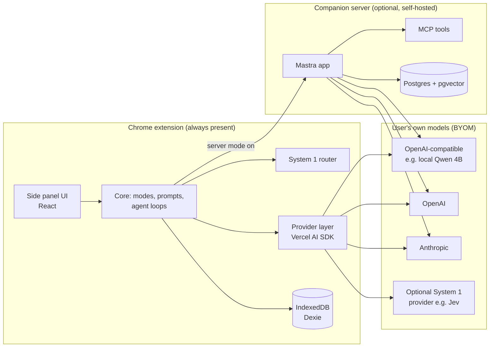

# Dev AI Learning Extension — Design

Date: 2026-11-22
Status: Draft for approval
Project name: Dev AI Learning Extension

## 1. Intent

Developers have to absorb technical material constantly — blog posts, research
papers, GitHub repositories, and documentation sites — and reading everything
end to end is too slow. The owner's own habit is: let AI skim and summarize,
then ask follow-up questions until the concept clicks.

This product turns that habit into a tool: a Chrome sidebar that **explains**
whatever technical thing the developer is looking at, in a layered "explain it
like I'm new to this" format, then lets them dig deeper through chat, web
research, and diagrams.

**Audience:** technical developers. "Like I'm five" means *new to this concept*,
not *new to programming* — examples use real code, real libraries, real files.

**Distribution:** v1 is an unpacked Chrome extension for the owner to use
locally. A public Chrome Web Store release is planned for later. Before that
release, review extension permissions, document which data goes to each model
provider, and add first-run guidance for configuring a model.

**Model policy:** bring your own model (BYOM). The product never hosts or
resells models. Users plug in an OpenAI-compatible endpoint (local Qwen,
Ollama, LM Studio, etc.), OpenAI, or Anthropic keys.

## 2. Goals

- Make a new technical concept understandable in under a minute, then
  explorable in depth.
- Work on the four source types developers actually read:
  1. Blog posts / articles (single page)
  2. Research papers (arXiv HTML/abs pages and PDFs with a text layer)
  3. GitHub repositories (whole repo, not just README)
  4. Documentation sites (whole site, not just one page)
- Run fully on a local model (owner's on-prem `Qwen3.5-4B-MLX-4bit`) with
  degraded-but-usable quality; get better with stronger BYO models.
- Use a **System 1** model role for fast typed decisions (routing,
  classification, relevance), separate from the generating model.
- Learn the owner's explanation preferences and common follow-up intents
  across reading sessions, with controls to inspect and change what is saved.

## 3. Non-goals

- Hosting models, proxying model traffic through a vendor server, or billing.
- A general chat app or a general browsing agent (no clicking/filling forms).
- OCR of scanned PDFs (no OCR model available; text-layer PDFs only).
- VS Code / IDE integration in this design (core is kept separable so it can
  be added later).
- Team accounts, multi-user auth, sharing (beyond a team pointing at one
  self-hosted companion server).

## 4. Anti-goals (would be a failure even if it "works")

- Keys leaving the user's control silently. Any time a key goes anywhere
  other than the model provider, the user must have explicitly enabled it
  and the UI must say so.
- Walls of summary text. If the output reads like a dense abstract, it has
  failed the intent — the layered learning view is the point.
- Requiring the companion server for basic use. Extension-only must be a
  complete product for single pages and repos.
- Hallucinated references: answers about a repo/doc site must link to the
  real file/page they came from.

## 5. Constraints

- Chrome Manifest V3 extension (side panel). MV3 service workers can be
  terminated by Chrome; long jobs cannot rely on them.
- Local model reference target: `mlx-community/Qwen3.5-4B-MLX-4bit` on an
  OpenAI-compatible MLX server (for example, `http://localhost:8080/v1`).
  Small model → prompts must be short, structured, and chunked; thinking mode
  disabled for System 1 calls.
- **Local server capabilities (probed 2026-11-22):** the server is
  `mlx_lm.server` 0.31.x (OpenAI-compatible, Python, macOS arm64).
  - Tool calling: **works** (`tools`, and forced `tool_choice` for a named
    function).
  - `response_format` / JSON schema: **ignored** — the model returns prose.
  - Thinking toggle: `chat_template_kwargs: {"enable_thinking": false}` per
    request **works**; with thinking on, the model emits a separate
    `reasoning` field.
  - Latency: ~1.3 s for a short prompt-only JSON reply (thinking off);
    ~5–7 s for a ~300-token prompt + tool call.
  - Context window: not probed; builder should measure and make chunk sizes
    configurable.
  - Consequence: System 1 structured output on OpenAI-compatible endpoints
    must use **forced tool call** (primary) or **prompt-only JSON + schema
    validation + one repair retry** (fallback), never rely on
    `response_format`. Provider profiles carry capability flags
    (`supportsToolCalls`, `supportsJsonSchema`, `thinkingToggle`) so the
    provider layer picks the strategy.
- No embedding model is available on the owner's local server today; any
  semantic search must degrade gracefully to keyword search (BM25).
- Page Assist (github.com/n4ze3m/page-assist) is MIT-licensed; code copied
  from it must retain its copyright/license notice.

## 6. User experience

### 6.1 The learning view (core output)

When the user opens the sidebar on a page and asks to learn it, sections
stream in top-first:

1. **Like I'm new** — 2–3 plain sentences: what this is, why it matters.
2. **Example** — a concrete analogy or tiny code example.
3. **Where it's used** — real use cases, real libraries/products.
4. **Step-by-step walkthrough** — how it actually works, numbered steps
   (paper: the method; repo: request/data flow through real files; docs: the
   workflow to accomplish the thing).
5. **Diagram** (when useful) — Mermaid flow/architecture diagram, rendered,
   with copy-as-Mermaid.
6. **Ask anything** — chat grounded in the page + the explanation above.

Depth toggle: **"New to this" (default) ↔ "More technical"**.

Latency (builder's call, soft target): first visible text as early as the
model allows. On the local 4B model, generate "Like I'm new" from a short
excerpt (title + first ~1–2k tokens) in parallel with System 1 page
classification instead of waiting for it; pre-extract page content when the
panel opens. "~2 seconds" is an aspiration for fast cloud models, not an
acceptance criterion on local hardware.

```
┌─ Learn: "Attention Is All You Need" ─┐
│ [New to this ▾]          model: qwen4b│
│ 🧒 Like I'm new                       │
│   ...                                  │
│ 🍎 Example         ▸                   │
│ 🛠 Where it's used ▸                   │
│ 🪜 Step by step    ▸                   │
│ 📊 Diagram         ▸                   │
│────────────────────────────────────────│
│ Ask a question...                 [→]  │
└────────────────────────────────────────┘
```

### 6.2 Modes by source type

| Mode | Input | Distinctive behavior |
|---|---|---|
| Page | Any article/blog/docs page | Extract main content, learning view + chat |
| Paper | arXiv abs/HTML/PDF | Walkthrough = problem → method → results → limits |
| Repo | github.com/{owner}/{repo} | Fetch tree + key files via GitHub API; architecture diagram linked to files; "how does X work" traces through code |
| Docs site | Any docs domain | Crawl & map the site; "how do I X?" answered from relevant pages with links; suggested reading path |
| Research | Any question | Plans sub-questions, web-searches, reads sources, cited answer |

### 6.3 Personal learning memory

The sidebar adapts the learning view and suggests follow-up questions about the
current page. For example, “Always use TypeScript examples” sets an explanation
preference. Questions about failure modes across several reading sessions can
lead to a suggested question about where the current page's design can fail.
Suggestions appear as optional prompts the user can select or ignore.

Explicit preferences apply immediately and override inferred patterns. A
one-off request guides the current session. Repeated signals across sessions
can become durable preferences, scoped to a topic when the evidence is
topic-specific. The current depth selection and question take priority in the
current interaction.

Memory settings show what is saved and why, with controls to edit, delete,
clear, or pause memory. Pausing stops recall and new learning. The UI explains
that selected memories are sent to the configured model when used in a prompt.

## 7. Architecture



### 7.1 Extension (TypeScript)

- **Framework:** WXT + React + Tailwind; Zustand for state; Dexie (IndexedDB)
  for chats, settings, page caches, and browser-side indexes.
- **Starting point:** a fresh WXT project, **harvesting specific modules from
  Page Assist** (MIT, attribution retained) rather than forking it:
  - main-content extraction from web pages
  - PDF text extraction (pdfjs)
  - Chrome side panel wiring
  - model/provider settings UI and OpenAI-compatible/Ollama/LM Studio quirks
  - Dexie storage setup
  Not taken: Ant Design UI, LangChain model layer, Page Assist's chat-centric
  app structure.
- **Provider layer:** Vercel AI SDK with providers: OpenAI-compatible (any
  base URL), OpenAI, Anthropic. Users configure one or more model profiles
  and assign them to roles (below).
- **Agent loops** (research, repo tracing, docs Q&A) are written by us on top
  of AI SDK tool-calling; they are the product's core.

### 7.2 Model roles

| Role | Job | Local default | Upgrades |
|---|---|---|---|
| **System 1** | Fast typed decisions: classify page type, route question (quick vs research vs needs-repo-trace), pick relevant chunks/pages, extract metadata | Qwen 4B, thinking off, forced tool calls or validated prompt JSON (see §5) | A dedicated System 1 model (e.g. TypeSafe Jev or similar) via the user's key |
| **Main** | Writes explanations, walkthroughs, diagrams, answers | Qwen 4B | Any stronger BYO model |
| **Embeddings** (optional) | Semantic search over repos/docs | none → BM25 keyword fallback | OpenAI embeddings or a locally served embedding model |

Dedicated System 1 models (e.g. Jev) are not chat models and may expose a
non-OpenAI API; they plug in through a separate **System 1 adapter** behind
the same role interface. v1 ships only the LLM-backed adapter (forced tool
call / prompt JSON, per §5); a Jev-style adapter is added when its API is
evaluated (builder's call).

System 1 is a **role interface**, not a specific model: input = typed
question + context, output = typed decision + confidence. Low-confidence
decisions fall back to a safe default (e.g. treat as "quick answer from
page").

### 7.3 Companion server (optional, self-hosted, TypeScript)

- **Stack:** Mastra (built on AI SDK, so prompts/provider code are shared
  with the extension), Postgres + pgvector, shipped as `docker compose up`.
- **Provides:**
  - Long-running jobs: deep research, docs-site crawl + index, large repo
    indexing — resumable, run in background, progress reported to the
    sidebar.
  - MCP tool hosting / tool execution (fetch, search, GitHub at scale, and
    user-added MCP servers).
  - pgvector storage for repo/doc indexes (shareable across a team pointing
    at the same server).
- **Never hosts or proxies a model of its own.** It calls the *user's* model
  endpoints.
- **Key transparency:** to run jobs, the server needs the user's model key.
  Keys are sent to the server only when the user turns on server mode; the
  settings UI states plainly "Your API key(s) will be sent to <server URL>",
  shows which keys, and offers per-provider opt-in. Server stores keys only
  if the user opts in; otherwise keys are sent per job and kept in memory.

### 7.4 Web search

Pluggable search providers via the user's own key: Brave Search, Tavily,
or a SearxNG instance URL (free, self-hosted). Without any configured,
research mode is disabled with a clear message.

### 7.5 Memory storage and recall

V1 borrows OpenViking's pattern of distilling durable observations from
sessions and loading relevant context in layers. A Dexie-backed repository
stores a compact preference profile, scoped observations and follow-up
patterns, and references to the user turns that support them. The application
loads the compact profile first, fetches scoped records relevant to the page or
question as needed, and opens supporting turns for inspection on demand.

System 1 can propose typed observations from user-authored requests and explicit
feedback after a response. Application code validates the proposal, deduplicates
retries, and decides what to persist. Page contents, generated answers, and
unclicked suggestions are excluded as evidence. User edits are authoritative,
and deleted records stop contributing to future prompts. The read path uses a
small prompt budget suitable for Qwen 4B, and extraction runs outside the first
response's critical path.

V1 runs in the browser using the existing IndexedDB and configured model
profiles. The repository interface allows a future OpenViking-backed adapter
through the optional companion server. Moving memory to that server would
require a separate decision about what session and preference data can be sent.

## 8. Approaches considered

| Approach | Trade-off | Decision |
|---|---|---|
| A. Fork Page Assist wholesale | Fast day one; inherits Ant Design, LangChain layer, chat-centric structure that fights learning view/repo/docs modes | Rejected |
| B. Fresh build, browser-only | Clean, zero install; long jobs limited by MV3 lifetimes | Base of chosen design |
| C. Thin extension + required server | Most powerful; forces every user to run a server | Rejected as *required* |
| **Chosen: B + harvested Page Assist modules + optional Mastra companion server** | Clean ownership, reuse of solved plumbing, server only for heavy work | **Picked by owner** |

Model-layer options considered: LangChain.js/LangGraph.js (powerful, heavy,
abstracts provider settings we need direct control over), no framework (max
control, rewrite streaming/tool loops), **Vercel AI SDK (chosen)** in the
extension, **Mastra** on the server for durable long-running agent jobs.

## 9. Delivery order

1. **v1 — Page learning:** side panel, BYOM settings (local Qwen + OpenAI +
   Anthropic), System 1 router wired in, learning view + chat on any single
   page, depth toggle, browser-local preferences and personalized follow-up
   suggestions.
2. **v2 — Repo mode:** GitHub API ingestion, architecture/flow Mermaid
   diagrams linked to files, code-tracing Q&A.
   - GitHub auth (builder's call): optional personal access token in
     settings, under the same key-transparency rules. Without a token,
     public repos only and ingestion stays within the 60 req/h
     unauthenticated limit (tree + System 1–selected key files, or a single
     tarball download). With a token, private repos are supported.
   - Extension-only repo mode = **selective understanding** (tree + the files
     System 1 judges relevant, fetched on demand), not full indexing. Full
     indexing of large repos is a companion-server job (v3). The exact size
     threshold is the builder's to set.
3. **v3 — Docs-site mode + companion server:** crawl/map docs sites,
   browser-side BM25 index for small sites; companion server (Mastra +
   pgvector + MCP) for large sites and background indexing.
4. **v4 — Research + papers:** web search providers, research agent with
   citations, paper-specific walkthroughs and PDF handling.

## 10. Decided by the owner

- Chrome sidebar extension; core kept separable for a future VS Code version.
- Audience: technical developers.
- Distribution: personal use for v1, with public release planned for later.
- Learning view format: explanation, example, use cases, step-by-step
  walkthrough, ELI5 tone.
- BYOM; local reference model `Qwen3.5-4B-MLX-4bit`.
- System 1 model role in the architecture.
- OpenViking-style memory in the extension for v1.
- Harvest Page Assist modules rather than fork wholesale.
- Optional companion server providing tools/MCP/pgvector and long jobs;
  model remains BYOM; sending keys to it is acceptable if transparent.
- Vercel AI SDK (extension) + Mastra (server).

## 11. Left to the builder

- Exact prompts and section-generation strategy (one call vs. per-section).
- Content-extraction details per site; chunking sizes for a 4B model.
- Crawl limits/politeness for docs sites; BM25 library choice.
- Diagram rendering library details (Mermaid version, pan/zoom).
- Server API shape between extension and companion server.
- Test strategy (unit tests on core, fixture pages/repos, model mocks).
